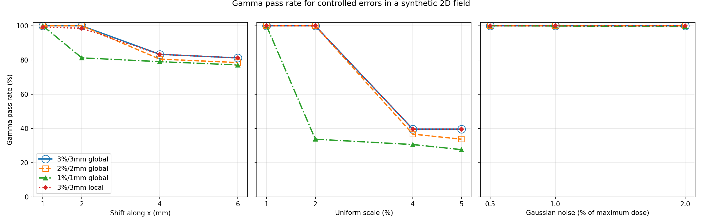

# Gamma index from scratch

A small, tested implementation of the gamma index (Low et al., 1998), the standard comparison used in radiotherapy quality assurance, with a study of how pass rates respond to controlled errors. A learning and demonstration project, not clinical software.



## What it does

`gamma_index(reference, evaluated, spacing_mm, dose_percent, dta_mm, local=False, cutoff_percent=10, max_gamma=2, step_mm=None)` returns the gamma value at every reference point on a regular grid (1D to 3D), with global or local dose normalisation, a dose cutoff, and linear interpolation of the evaluated distribution on a fine search grid. `pass_rate(gamma)` returns the percentage of points with gamma at most 1 (with a numerical tolerance of 1e-9).

```python
from gammaqa import gamma_index, pass_rate
g = gamma_index(ref, evaluated, spacing_mm=1.0, dose_percent=3, dta_mm=3)
print(pass_rate(g))
```

Limits: reference and evaluated must be on the same grid, and the fields here are synthetic.

## Validation

13 tests (`python -m pytest`), each with an answer derived on paper:

- identical distributions give gamma 0; points under the dose cutoff are excluded;
- a pure shift of s mm gives gamma at most s / DTA;
- a uniform scale error on a flat region gives exactly error / tolerance (2% against 3% gives 0.667, 4% gives 1.333);
- local normalisation obeys the same bound; a 2D diagonal shift obeys gamma at most |shift| / DTA;
- an error exactly at the tolerance counts as a pass (it is gamma = 1 plus rounding noise otherwise);
- the vectorised N-dimensional code agrees with an independent brute-force 1D implementation.

The tests do not compare against another gamma implementation, so agreement with other software is not shown here.

## Scenarios

A synthetic 100 x 100 mm field with a 3 mm penumbra on a 200 x 200 mm grid (1 mm spacing), compared with shifted, scaled and noisy copies. The scenarios, criteria and expectations were fixed in [`PLAN.md`](PLAN.md) before this run. Pass rate (%), dose cutoff 10%, gamma capped at 2:

| Scenario | 3%/3 mm global | 2%/2 mm global | 1%/1 mm global | 3%/3 mm local |
|---|---|---|---|---|
| identical | 100.00 | 100.00 | 100.00 | 100.00 |
| shift 1 mm | 100.00 | 100.00 | 100.00 | 99.27 |
| shift 2 mm | 100.00 | 100.00 | 81.26 | 98.56 |
| shift 4 mm | 83.33 | 80.52 | 79.05 | 83.33 |
| shift 6 mm | 81.23 | 78.52 | 77.12 | 81.23 |
| scale +1% | 100.00 | 100.00 | 100.00 | 100.00 |
| scale +2% | 100.00 | 100.00 | 33.69 | 100.00 |
| scale +4% | 39.62 | 36.67 | 30.57 | 39.62 |
| scale +5% | 39.62 | 33.69 | 27.59 | 39.62 |
| noise 0.5% | 100.00 | 100.00 | 100.00 | 100.00 |
| noise 1% | 100.00 | 100.00 | 99.91 | 99.99 |
| noise 2% | 100.00 | 100.00 | 99.56 | 100.00 |

Global criteria use a search step of DTA/10 and local DTA/20. Full output: [`results/scenarios.csv`](results/scenarios.csv).

### Expectations written in advance, and what happened

| Expectation | Result |
|---|---|
| Identical distributions pass 100% | Held |
| Pass rate does not rise as the error grows | Held, except local with noise (99.99% at 1%, 100.00% at 2%): one point in about 10,000, with a different noise draw at each level |
| Tighter criteria never pass more | Held in every scenario |
| A shift at or below the DTA passes 100% | Held for global criteria. Local gave 99.27% and 98.56%, which is a search-step artefact (below) |
| Scale error below tolerance passes, above it fails the flat region | Held; errors exactly at the tolerance pass |
| Local is at least as strict as global | Held; never higher |
| Noise lowers the pass rate, tight criteria first | The direction held, the size did not: see below |
| Halving the search step changes little | Global: at most 0.02 points. Local: 0.73 points at the 1 mm shift, 0 at scale +4% |

### What the results show

- **Local gamma has not fully converged.** For the 1 mm shift, local 3%/3 mm gives 99.27% at DTA/20 and 100.00% at DTA/40, although theory says 100%. Local tolerance is tiny where the dose is low, so results depend on how finely the search is done. The local numbers for the 1 and 2 mm shifts are lower bounds. Global results were stable (differences up to 0.02 points).
- **Gamma is nearly blind to random noise unless the distance criterion is tight.** With noise of 2% of the maximum dose against a 1% dose tolerance, the pass rate is still 99.56% (1%/1 mm in the scenario table). In an exploratory check added after the main run (one noise draw, 1% dose tolerance), shrinking the DTA lowered the pass rate to 99.54% (1.0 mm), 84.46% (0.5 mm), 57.59% (0.2 mm) and 45.52% (0.1 mm), where the comparison is almost point by point. So it is the search over neighbouring points that absorbs the noise. On a flat region a point-by-point comparison would pass about 38% of points (noise within half a standard deviation of the tolerance), so 45.5% is plausible. This is one noise draw on one field.
- **Pass rate saturates.** For scale errors of 4% and 5% at 3%/3 mm the pass rate stays at 39.62%: the flat high-dose region fails whatever the size of the error, while the penumbra passes thanks to the distance criterion. A pass rate alone does not say how large the error is.
- **Numerical detail.** A 3% error against a 3% tolerance gives gamma = 1 + 9e-16, which made the pass rate about 50% until a 1e-9 tolerance was added.
- **The search step matters.** In a development run, a coarser step (DTA/5) changed the 2%/2 mm pass rate by up to 4.8 points compared with DTA/10, which is why the scenarios use finer steps. See the deviation log in `PLAN.md`.

## Process notes

The plan was committed before the scenarios were run, but an earlier development run of the scenario script had already been seen, so the expectations were not checked blind. Two settings changed after that run (search step; pass tolerance), both recorded in `PLAN.md`.

## Limitations

Synthetic fields only; one field shape and one grid spacing; same-grid requirement; linear interpolation (coarse grids add interpolation error); no comparison with another gamma implementation or with measured data; no 3D clinical use.

## Run it

```
pip install -r requirements.txt
python -m pytest -q
python scripts/run_scenarios.py     # about 10-15 minutes, writes results/
python scripts/plot_results.py      # redraws the figure from results/scenarios.csv
```

## Layout

```
gammaqa/       gamma_index and pass_rate
tests/         unit tests
scripts/       run_scenarios.py, plot_results.py
results/       scenarios.csv, step_convergence.csv, pass_rates.png
PLAN.md        plan, expectations and deviation log
```

## Licence

MIT.
